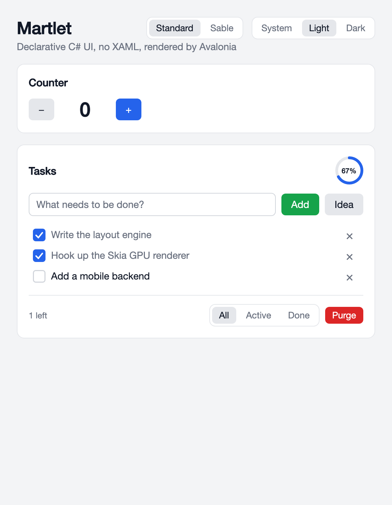
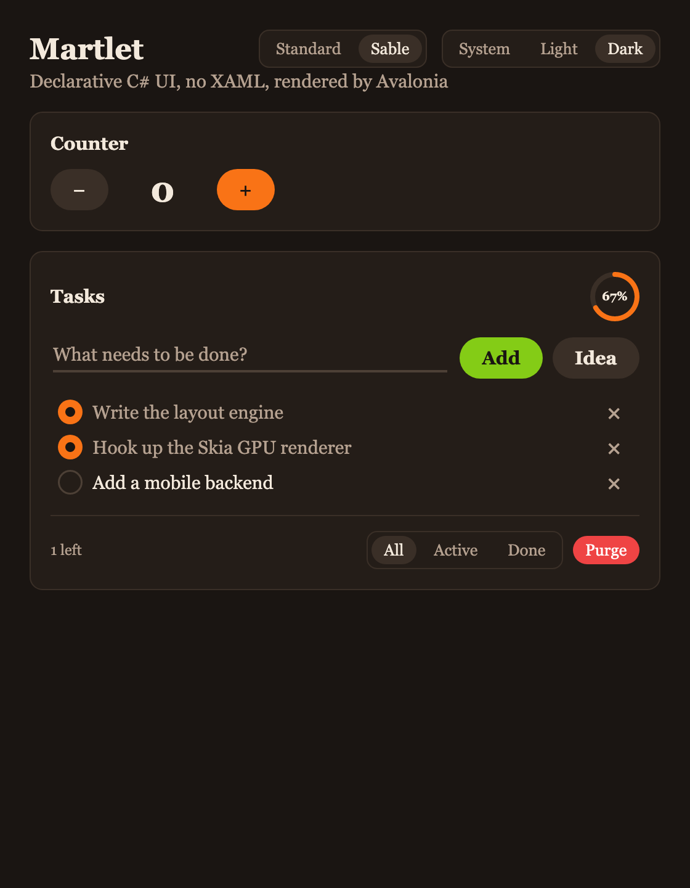

# Avalonia.UI.Reactor

[](#avaloniauireactor)
[](LICENSE)
[](https://dotnet.microsoft.com/)
[](https://avaloniaui.net/)
[](#supported-platforms)

**Avalonia.UI.Reactor** is a declarative UI framework for .NET: you write your user interface in C#, in the style of
SwiftUI and Jetpack Compose, and [Avalonia](https://avaloniaui.net/) renders it with its own controls. No XAML,
no view models, no bindings to wire: a component is some state and a `Body`.

```csharp
ReactorApp.Run<CounterApp>("Counter", 400, 300);

public sealed partial class CounterApp : Component
{
    [State] partial int Count { get; set; }

    public override View Body =>
        HStack(() =>
        {
            Button("−", () => Count--).Style(ButtonStyle.Secondary);
            Text($"{Count}").Font(TextStyle.Title);
            Button("+", () => Count++);
            if (Count != 0)
                Button("Reset", () => Count = 0).Style(ButtonStyle.Ghost);
        })
        .Padding(24);
}
```

A stack takes its children as arguments, `HStack(a, b)`, or as a block, as above: each view statement of the block is
a child, and `if`, `switch` and local variables decide which views are shown, as in a SwiftUI `@ViewBuilder`.

Controls bind to state with the generated `Bind` property: `Bind.Name` is a `Binding<string>` that the field reads and
writes, so there is no event handler to write.

```csharp
public sealed partial class SignUp : Component
{
    [State] partial string Name { get; set; } = "";
    [State] partial bool Newsletter { get; set; }

    public override View Body =>
        VStack(
            TextField(Bind.Name, "Your name"),               // reads and writes Name
            Checkbox(Bind.Newsletter, "Send me the news"),   // reads and writes Newsletter
            Text(Name.Length == 0 ? "Hello!" : $"Hello, {Name}!"))
        .Padding(24);
}
```

<p align="center">
  
  &nbsp;
  
</p>

> [!WARNING]
> Avalonia.UI.Reactor is **experimental**. The API can change at any time and the packages are not published to
> NuGet. Do not use it in production yet.

## Features

- **Concise C# views.** Views are immutable records built with factory functions (`Text`, `Button`, `VStack`…) and
  chainable modifiers (`.Padding(16)`, `.Background(…)`). The common case fits on one line.
- **Fine-grained reactivity.** Properties marked `[State]` are generated at compile time. A change re-evaluates only
  the components and the view methods that read it, whether it comes from an action, after an `await` or from a
  background thread.
- **Generated two-way bindings.** `TextField(Bind.Draft)`, `Checkbox(todo.Bind.Done)`: each `[State]` property gets
  its binding, like `$draft` in SwiftUI.
- **Real Avalonia controls.** A reconciler maps each view to an Avalonia control and keeps it from one update to the
  next, so focus, text selection, input methods and scrolling inside fields come from Avalonia.
- **Themes declared by the view.** Light and dark families that follow the system, named colors and styles, and
  `.Theme("Sable")` on any view or component. No visual value is hard-coded.
- **Control templates.** Replace the whole look of a button, checkbox or text field with a view, keeping its behavior.
- **View builder blocks.** `VStack(() => { … })` takes `if`, `switch` and local variables, and `Show(…)` adds any
  view; the generator intercepts each view statement at compile time, so the code runs as written, and the IDE offers
  fixes such as "Convert to block".
- **View lifecycle.** `.OnAppear`, `.OnDisappear` and `.Task`, whose task is cancelled when the view disappears.
- **Compile-time diagnostics.** Analyzers report misuses (`MVU001`–`MVU017`) with the fix in the message.
- **Hot reload.** Edit a `Body` and save: the window updates in about a second and keeps its state.
- **Escape hatch.** Any Avalonia control can be embedded with `Native(() => new Calendar())`.

## Getting started

### Prerequisites

- [.NET 10 SDK](https://dotnet.microsoft.com/download)
- Windows, macOS or Linux

### Run the sample app

```bash
git clone https://github.com/eloam/Avalonia.UI.Reactor.git
cd Avalonia.UI.Reactor
dotnet run --project samples/TodoDemo
```

For hot reload, run `dotnet watch --project samples/TodoDemo` and edit any `Body`.

### Use it in your app

Until the packages are on NuGet, reference the projects from source. The runtime brings the core; the generators and
the code fixes are added as analyzers, and the build rules of the core package are imported (they allow the code that
the generator writes for view builder blocks):

```xml
<ItemGroup>
  <ProjectReference Include="..\Avalonia.UI.Reactor\src\Avalonia.UI.Reactor\Avalonia.UI.Reactor.csproj" />
  <ProjectReference Include="..\Avalonia.UI.Reactor\src\Avalonia.UI.Reactor.Generators\Avalonia.UI.Reactor.Generators.csproj"
                    OutputItemType="Analyzer" ReferenceOutputAssembly="false" />
  <ProjectReference Include="..\Avalonia.UI.Reactor\src\Avalonia.UI.Reactor.CodeFixes\Avalonia.UI.Reactor.CodeFixes.csproj"
                    OutputItemType="Analyzer" ReferenceOutputAssembly="false" />
</ItemGroup>

<Import Project="..\Avalonia.UI.Reactor\src\Avalonia.UI.Reactor.Core\buildTransitive\Avalonia.UI.Reactor.Core.targets" />
```

Then import the namespaces once, in a `GlobalUsings.cs` file:

```csharp
global using Avalonia.UI.Reactor;
global using static Avalonia.UI.Reactor.Views.Ui;
```

## Documentation

| Topic | Description |
|---|---|
| [Reactive state](docs/state.md) | `[State]`, `StateList`, bindings, scopes, the generator and its diagnostics |
| [Writing views](docs/views.md) | Controls, stacks, modifiers, actions, async code, errors, drawing and embedding Avalonia controls |
| [Theming](docs/theming.md) | Themes and families, the catalog, named tokens and control templates |
| [Windows and menus](docs/windows-and-menus.md) | Window options, zoom, the menu bar and keyboard shortcuts |
| [Architecture](docs/architecture.md) | How the reconciler works, the projects and the repository layout |

## Supported platforms

| Platform | Status |
|---|---|
| macOS | Supported, including the system menu bar |
| Windows | Supported by Avalonia; not yet verified with this version of the framework |
| Linux | Supported by Avalonia; not yet verified with this version of the framework |
| iOS, Android, browser | Planned: Avalonia runs there, the framework still needs a mobile and a browser host |

## Building from source

```bash
dotnet build Avalonia.UI.Reactor.sln
dotnet test Avalonia.UI.Reactor.sln
```

The build treats every warning as an error. Tests open real Avalonia windows without a screen (Avalonia.Headless),
so they run on any machine.

## Roadmap

`ScrollView` and virtualized lists, multiline text, images, input controls (`Toggle`, `Picker`, `Slider`),
navigation and modal sheets, animations, accessibility labels, then mobile and browser hosts.

## Contributing

Contributions are welcome. Please read [CONTRIBUTING.md](CONTRIBUTING.md) before opening a pull request.

## License

Avalonia.UI.Reactor is licensed under the [MIT license](LICENSE).
